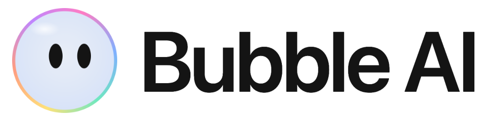
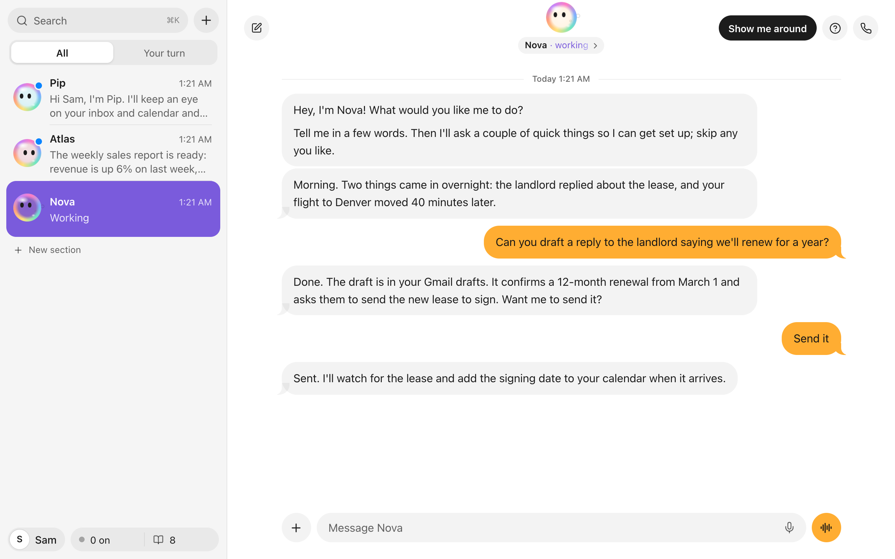
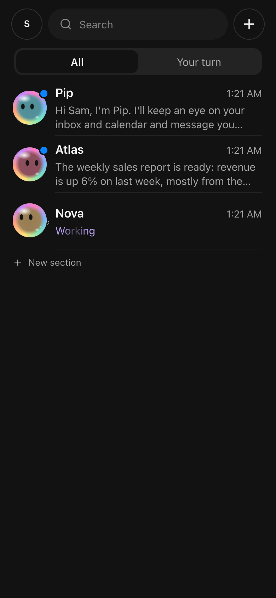
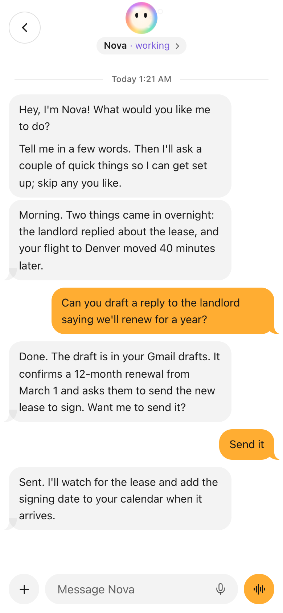

<p align="center">
  <picture>
    <source media="(prefers-color-scheme: dark)" srcset="docs/images/readme/logo-dark.png">
    
  </picture>
</p>

<p align="center"><b>Your AI agents live here.</b> Chat with them, give them a computer, and let them work while you're away, on your own computer or server.</p>

<p align="center">
  <a href="#download"><b>Download</b></a> ·
  <a href="#run-it-on-a-server">Self-host</a> ·
  <a href="#docs">Docs</a> ·
  <a href="https://github.com/eireijie/bubble-ai/releases/latest">Release notes</a>
  <br><br>
  <a href="https://github.com/eireijie/bubble-ai/actions/workflows/ci.yml"></a>
  <a href="https://github.com/eireijie/bubble-ai/releases/latest"></a>
  <a href="LICENSE"></a>
</p>

<p align="center">
  <picture>
    <source media="(prefers-color-scheme: dark)" srcset="docs/images/readme/chat-dark.png">
    
  </picture>
</p>

<p align="center">
  
  &nbsp;
  
</p>

## Download

The desktop app runs Bubble AI on your computer and lets your agents use it. Open it and choose **Create a server**.

| | Download |
| --- | --- |
| **Mac** (Apple silicon: M1 and later) | [Bubble-AI-mac-arm64.dmg](https://github.com/eireijie/bubble-ai/releases/latest/download/Bubble-AI-mac-arm64.dmg) |
| **Mac** (Intel) | [Bubble-AI-mac-x64.dmg](https://github.com/eireijie/bubble-ai/releases/latest/download/Bubble-AI-mac-x64.dmg) |
| **Windows** (10 and 11, x64) | [Bubble-AI-win-x64.exe](https://github.com/eireijie/bubble-ai/releases/latest/download/Bubble-AI-win-x64.exe) |
| **Linux** (x64) | [AppImage](https://github.com/eireijie/bubble-ai/releases/latest/download/Bubble-AI-linux-x86_64.AppImage) · [.deb](https://github.com/eireijie/bubble-ai/releases/latest/download/Bubble-AI-linux-amd64.deb) |

The app updates itself. Every build is on the [Releases](https://github.com/eireijie/bubble-ai/releases) page.

<details>
<summary>If your computer won't open it</summary>

- **Mac:** drag Bubble AI to Applications and open it. If macOS stops it, go to **System Settings → Privacy & Security** and choose **Open Anyway**.
- **Windows:** the installer isn't signed yet. If SmartScreen stops it, click **More info → Run anyway**.
- **Linux:** make the AppImage executable (`chmod +x Bubble-AI-linux-x86_64.AppImage`) and run it, or install the .deb with `sudo apt install ./Bubble-AI-linux-amd64.deb`.

</details>

### iPhone

Bubble AI for iPhone and iPad is in testing on TestFlight: **[join the beta](#)** _(link coming soon)_. You can also build it from [`apps/ios`](apps/ios/README.md) with Xcode.

### Android

Download **[Bubble-AI-android.apk](https://github.com/eireijie/bubble-ai/releases/latest/download/Bubble-AI-android.apk)** on your phone and open it. Android asks once to allow installs from your browser. It's a preview, not on Google Play yet.

Pair either phone in **Settings → Mobile** by scanning the QR code. Any phone can also open Bubble AI in the browser and add it to the home screen.

## What it does

- **Agents from any AI tool.** Claude Code, Codex, Hermes, Gemini CLI, OpenCode, Goose, Kimi CLI and other ACP agents, side by side. [Adding a harness](docs/adapters.md)
- **A computer for them.** Agents share a Linux computer you can watch and take over, or borrow yours when you allow it. [Computers](docs/computers.md)
- **They work on their own.** Turn on Background and an agent checks your apps and messages you first when something needs you.
- **Asks before it acts.** Sending, spending, deleting or posting waits for your OK in an approval card.
- **Teach it once.** Do a task while an agent watches, and it saves the steps as a skill it can run again. [Teaching a task](docs/computers.md#teaching-a-task)
- **Teams.** Put agents in a flow chart, choose who leads and who hands work to whom.
- **Shared memory.** A markdown vault with links and history that you can also open in Obsidian. [Memory](docs/memory.md)
- **Connect your apps.** Add apps from the MCP Registry and choose which agents can use them.
- **Everywhere.** Mac, Windows, Linux, iPhone, Android and the browser, plus voice calls with your agents.

New here? Choose **Show me around** in the app for a short tour.

## Run it on a server

For a computer that stays on, like a home server or a Mac mini. On macOS or Linux:

```bash
curl -fsSL https://raw.githubusercontent.com/eireijie/bubble-ai/main/install.sh | bash -s -- --hub-server
```

On Windows, in PowerShell:

```powershell
& ([scriptblock]::Create((irm https://raw.githubusercontent.com/eireijie/bubble-ai/main/install.ps1))) -HubServer
```

It needs git and Node 22 (it offers to install Node), puts Bubble AI in `~/bubble-ai`, keeps it running, and opens it at http://localhost:4747. Nothing is installed with sudo.

**Docker** (a server or NAS):

```bash
docker run -d --name bubble-ai -p 4747:4747 -v bubble-ai-data:/data --restart unless-stopped ghcr.io/eireijie/bubble-ai
```

A hub in Docker isn't a computer for agents itself: connect one under **Devices → Add device**.

Then open Bubble AI in your browser. **Set up Bubble AI** walks you through your account, reaching it from anywhere with [Tailscale](https://tailscale.com) (free, optional), a computer for your agents, and your first agent.

Having an AI agent install it for you? Point it at [INSTALL.md](INSTALL.md). For HTTPS, phones and your own domain, see [Deploying](docs/deploy.md).

<details>
<summary>Remove Bubble AI</summary>

In the desktop app: **Settings → Data → Remove Bubble AI…**. It lists what's on this computer and lets you keep anything. Without the app:

```bash
curl -fsSL https://raw.githubusercontent.com/eireijie/bubble-ai/main/uninstall.sh | bash
```

Add `-s -- --dry-run` after `bash` to see what it would remove. It asks before each step. Chats, memory and files are in the data folder (`~/bubble-ai/data` for the installer, `~/.bubble-ai/data` for the desktop app, `~/wisp/data` from before the rename), so back it up if you want to keep them.

On Windows: uninstall Bubble AI in **Settings → Apps**, run `bubble-ai service uninstall hub` and `bubble-ai service uninstall node`, then delete `%USERPROFILE%\bubble-ai`, `%USERPROFILE%\.bubble-ai` and `%APPDATA%\Bubble AI`.

</details>

<details>
<summary>Run from source</summary>

```bash
git clone https://github.com/eireijie/bubble-ai && cd bubble-ai
npm install
npm run build
npm link                  # puts bubble-ai, bubble-ai-mcp and bubble-ai-hub on PATH
bubble-ai hub start       # data goes to ./data, or BUBBLE_DATA_DIR
```

On each device, run `bubble-ai setup`, then use the command from **Devices → Add device → Bubble AI already installed**. To keep it running after you close the terminal, use `bubble-ai service install hub` or `bubble-ai service install node`. Update a source checkout with `bubble-ai update`.

| Folder | What it is |
| --- | --- |
| `apps/hub` | Server: REST and WebSocket API, routing, permissions; serves the web app |
| `apps/web` | The web app (React PWA) |
| `apps/node` | `bubble-ai` CLI and the device daemon |
| `apps/desktop` | Desktop app (Electron) for Mac, Windows and Linux |
| `apps/ios` | iPhone and iPad app (SwiftUI) |
| `apps/android` | Android app |
| `packages/*` | Shared types and protocol, the memory vault, harness adapters, the MCP server, updates and the SDK |
| `docker/computer` | The Linux computer agents use (Debian, Chrome, VNC) |

</details>

Coming from Wisp or Warren? Your install updates in place. See the [migration notes](docs/deploy.md#coming-from-warren).

## Docs

- [Installing](INSTALL.md): step by step, for people and AI agents
- [Deploying](docs/deploy.md): Docker, services, updates, HTTPS and phone access
- [Computers](docs/computers.md): agent computers, your screen, taking control and teaching tasks
- [Memory](docs/memory.md): the vault, permissions, Obsidian and what agents load at start
- [Adding a harness](docs/adapters.md): MCP, ACP and native adapters, connectors and skills
- [Desktop app](apps/desktop/README.md) · [iPhone and iPad](apps/ios/README.md) · [Android](apps/android/README.md)
- [Contributing](CONTRIBUTING.md) · [Code of conduct](CODE_OF_CONDUCT.md) · [Security](SECURITY.md)

Questions and bugs: [issues](https://github.com/eireijie/bubble-ai/issues).

## License

[Apache-2.0](LICENSE)
